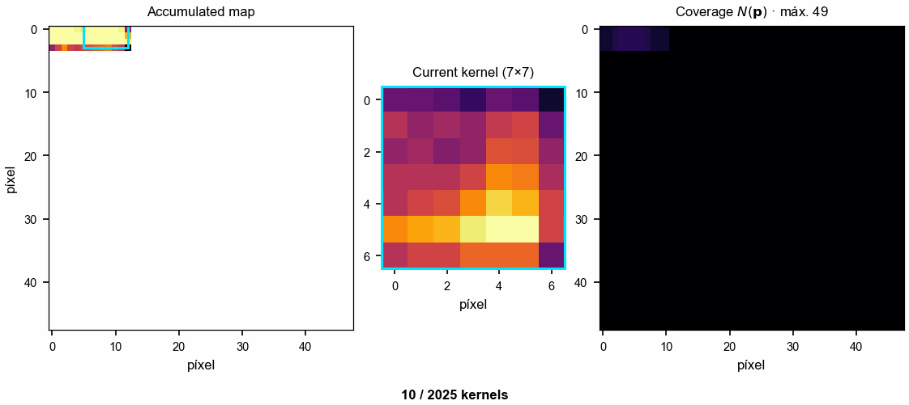
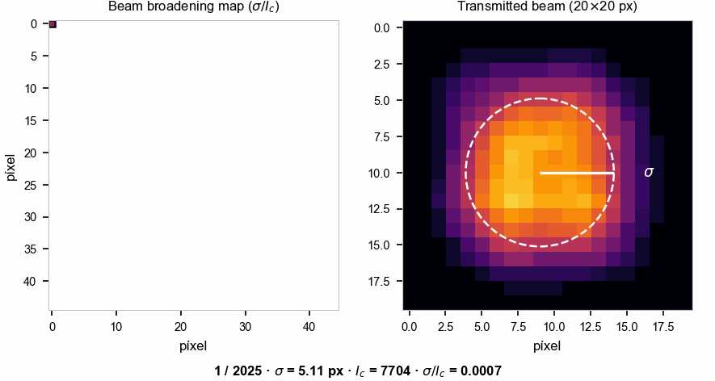
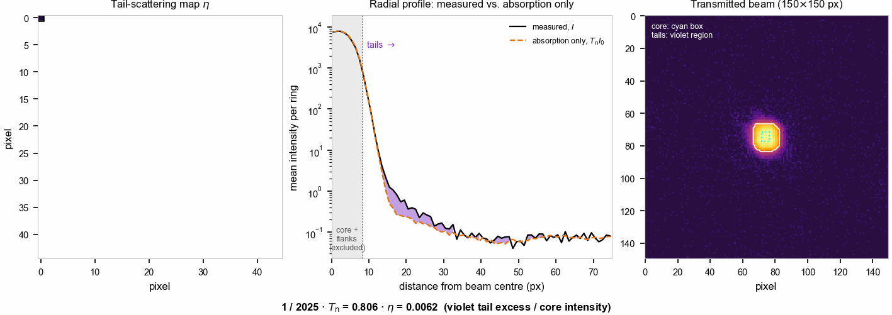
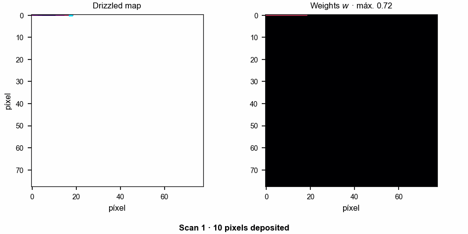
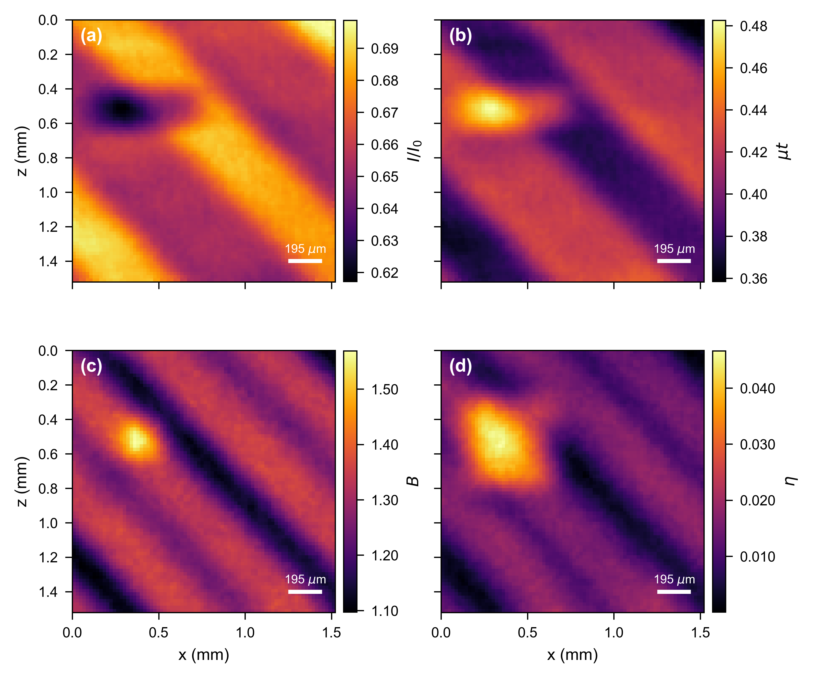
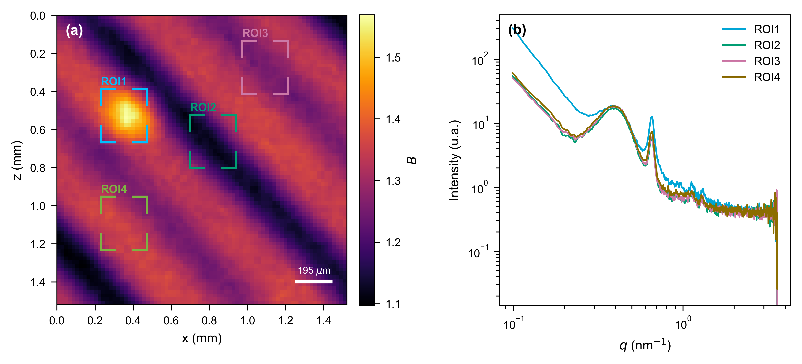

# Multimodal X-ray mapping from the transmitted beam

Reference implementation of the mapping workflow described in

> **Multimodal X-ray mapping from the transmitted beam to guide localized SAXS/WAXS on a
> laboratory instrument.**
> G. Quintero-Marquina, F. Britto, E. Pacheco, B. Araoz, D. G. Lamas, C. Huck-Iriart.

The method turns a commercial laboratory SAXS/WAXS instrument (Xenocs Xeuss 2.0) into a
two-dimensional mapping system without any instrumental modification. It uses the intrinsic
divergence of the beam as a geometric magnifier, and recombines two interlaced raster scans
with the *drizzle* algorithm to reach a sampling step of 19.5 µm. From a single acquisition
the same transmitted-beam images yield four complementary maps — transmission, absorption,
beam broadening and tail scattering. The beam-broadening map is used to locate
heterogeneities and to place the regions of interest (ROIs) at which localized SAXS/WAXS is
subsequently measured; the tail-scattering map confirms, before any localized measurement,
that those regions scatter more than their surroundings.

The notebook covers the **PHBV + Bioglass 4 wt %** system.

## Contents

```
multimodal_mapping_PHBV_BG4.ipynb   the workflow, from the scan data to the SAXS/WAXS profiles
data/                               reduced dataset (~22 MB), enough to run the notebook
tools/make_reduced_dataset.py       how data/ was derived from the raw detector frames
requirements.txt                    Python dependencies
```

## Running it

```bash
pip install -r requirements.txt
jupyter lab multimodal_mapping_PHBV_BG4.ipynb
```

Everything the notebook needs is in this repository; no access to the raw experimental data
is required. It runs end to end in less than a minute.

## What the notebook does

```
raster scans  ->  construction kernels  ->  transmission, beam-broadening and
                                            tail-scattering maps
              ->  drizzle (sub-pixel recombination)
              ->  transmission T, absorption mu*t, beam broadening B,
                  tail scattering eta
              ->  ROI selection on B  ->  localized SAXS / WAXS profiles
```

| map | symbol | definition |
|---|---|---|
| transmission | *T* | *I* / *I*₀ |
| absorption | *μt* | −ln *T* |
| beam broadening | *B* | (σ/*I*_c) / (σ₀/*I*_c,₀) |
| tail scattering | *η* | Σ<sub>tails</sub> (*I* − *T*<sub>n</sub>*I*₀) / Σ<sub>core</sub> *T*<sub>n</sub>*I*₀ |

The notebook computes the four maps. *η* is evaluated on a 150 × 150 px window around the
beam, with the tails restricted to the pixels outside the 0.05–0.95 quantile box where the
direct beam is below 5 % of its maximum (`TAIL_I0_THRESHOLD`); for this sample any threshold
up to 10 % gives no negative values, and the notebook shows that check.

## The data

The raw experiment is about **4.2 GB**: 5593 detector frames of 407 × 487 float32 pixels
for the raster scans, plus the localized SAXS/WAXS acquisitions. That is impractical to
host here, so this repository ships a **reduced dataset of ~22 MB** in `data/`.

The reduction is not arbitrary. Of each 407 × 487 detector frame the pipeline only ever
reads a window centred on the beam: a 7 × 7 construction kernel for the transmission map,
the central 20 × 20 region of the 60 × 60 analysis window for the beam-broadening map, and a
150 × 150 window for the tail-scattering map. `data/` therefore stores the 150 × 150 window —
a superset of the three — together with the motor coordinates and exposure times.
Cropping a kernel from the stored
window is the same arithmetic as cropping it from the full frame, so **the maps built from
the reduced dataset are bit-identical to those built from the raw frames** (verified
against the full dataset).

| file | contents |
|---|---|
| `scan_windows.npz` | `windows` (2048, 150, 150) detector windows, one per scan point; `positions` (2048, 2) motor coordinates (x, z) in mm; `exposure` (2048,) in s; `blocks` the two interlaced scans |
| `direct_beam.npz` | `windows` (100, 80, 80) direct-beam windows; `tail_windows` (100, 150, 150) the same frames cropped on the detector pixels of the scan windows; `exposure`; `centroid_full_frame` (100, 2) per-frame centroids computed on the full frames |
| `saxs_rois.npz` | `frames` (3, 407, 487) 2D SAXS patterns measured at ROI1–ROI3 |
| `waxs_rois.csv` | azimuthally integrated WAXS profiles at ROI1–ROI3 (2θ in degrees) |
| `metadata.json` | instrument, scan, direct-beam, SAXS and WAXS parameters, and the measured ROI motor coordinates |

### One step that cannot be recomputed from the reduced data

The beam centroid used to place the direct-beam kernel is an intensity-weighted centroid of
the **full** detector frame. Recomputing it on an 80 × 80 crop shifts it by ≈ 0.9 px in *z*,
because the asymmetric background outside the crop contributes to the full-frame value. The
precomputed per-frame centroids are therefore stored in `direct_beam.npz`, and the windows
were cropped around the corresponding reference pixel so that every kernel extraction
downstream is exact. The notebook shows this comparison explicitly.

The tail-scattering map compares each scan image with the direct beam pixel by pixel, so
both must cover the same detector pixels. The scan windows are centred one column away from
the direct-beam reference pixel, so the direct-beam frames are stored a second time, cropped
on the scan pixels (`tail_windows`). *I*₀ and *B*₀ keep using the original crop, so the
transmission and beam-broadening maps are unchanged.

### Regenerating `data/` from the raw frames

`tools/make_reduced_dataset.py` documents the exact provenance of every array (source
folder, frame range, reference pixel and the convention used for it). Pointing it at the
raw acquisition folders regenerates `data/` from scratch:

```bash
python tools/make_reduced_dataset.py /path/to/raw_data -o data
```

The raw frames are kept outside this repository and are available from the authors.

## The method, step by step

The animations and figures below illustrate the full workflow, from the raster scan to the
localized SAXS/WAXS measurements. They were produced with the animation and figure routines
of the full analysis notebook (not included here, since they are not needed to reproduce
the maps).

> **Note.** This section follows the **PLA + SBA-15 4 wt %** sample, the other system
> studied in the article, whose larger scan (2025 points per raster) makes the mechanism
> easier to follow. The notebook in this repository processes the PHBV + BG 4 % sample,
> so the maps it produces look different — the procedure is identical.

### 1. Transmission map, kernel by kernel

Each scan point contributes a 7 × 7 construction kernel, deposited on the common grid at
the motor position where it was acquired. Neighbouring kernels overlap, so each map pixel
accumulates several contributions and is divided by its coverage *N*(**p**) (right panel).
The map is finally cropped to the region where *N* = 49, the only one with complete
coverage. Normalizing by the direct-beam intensity gives *T* = *I*/*I*₀, and the absorption
map follows as *μt* = −ln *T*.



### 2. Beam-broadening map, point by point

Here each scan point yields a single scalar instead of a kernel: the radial second moment σ
of the transmitted beam divided by the intensity at its centroid *I*<sub>c</sub>, both
measured on the analysis window (right panel, with σ drawn as the dashed circle), and
normalized by the same quantity for the direct beam. *B* combines the angular broadening of
the beam with the loss of central intensity, and is the map used to locate heterogeneities.



### 3. Tail-scattering map, point by point

The transmitted image contains two contributions: photons that cross the sample undeviated,
which keep the profile of the incident beam attenuated by absorption, and photons scattered
at ultra-small angles, which spread into the tails of the beam. At each scan point:

1. the transmission *T*<sub>n</sub> is fitted in the **core** of the beam (central region
   between the 0.25 and 0.75 quantiles of the direct-beam projections), where scattering
   is negligible;
2. *T*<sub>n</sub> *I*₀ gives the image that would be recorded if the sample only absorbed;
3. the excess of the measured image over this reference is summed over the **tails**
   (outside the 0.05–0.95 quantiles and where the direct beam is below 5 % of its maximum)
   and normalized by the transmitted intensity in the core.

*η* is therefore the intensity scattered into the tails per unit of transmitted intensity:
*η* = 0 for a purely absorbing sample. In the animation, the left panel shows the *η* map
being filled, the centre panel the radial profile of the measured beam against the
absorption-only reference (the violet area is the excess summed by *η*), and the right
panel the transmitted beam with the core (cyan box) and the tails (violet region). Because
each value integrates the scattering of the whole illuminated region, features appear
broadened by about the beam footprint on the sample (0.24 × 0.28 mm).



### 4. Sub-pixel recombination by drizzle

The two interlaced scans, offset by half a motor step, are deposited on a grid of half the
step. Each input pixel is shrunk to `pixfrac` = 0.6 of its size before being dropped, which
is what turns the half-step offset into distinct output positions instead of an average.
The right panel shows the accumulated weight converging to a uniform *w* = 0.72. The same
recombination is applied to the transmission, beam-broadening and tail-scattering maps.



### 5. The four multimodal maps

After drizzle, every map covers 1.52 × 1.52 mm with a sampling step of 19.5 µm.
Transmission (a) and absorption (b) describe the projected optical thickness and reveal
the diagonal raster pattern of the 3D-printed part. Beam broadening (c) shows the same
pattern plus a localized heterogeneity of ~0.2 mm with sharply defined contours. Tail
scattering (d) is dominated by that heterogeneity, which reaches 3.4 times the matrix level,
while the raster pattern persists only as a weak modulation; the heterogeneity appears
larger than in *B* because *η* integrates the scattering of the whole beam footprint.



### 6. Localized SAXS at the regions of interest

Four ROIs are placed on the *B* map: ROI1 on its maximum, located automatically, and
ROI2–ROI4 on the base structure as references for the matrix. Each ROI has the size of the
beam footprint (0.24 × 0.28 mm). Their physical coordinates are recovered from the map grid
and used to reposition the motorized sample stage (precision < 5 µm), where SAXS is
measured at 1.2 m for 2400 s per ROI.

ROI2–ROI4 show practically identical profiles, with the (100) correlation peak of the
hexagonal *p6mm* mesostructure of SBA-15 at *q*<sub>100</sub> ≈ 0.654 nm⁻¹
(*d*<sub>100</sub> ≈ 9.6 nm). In ROI1 the integrated area of the (100) peak is 2.4(6) times
that of the matrix, with no change in its position or width, and the intensity rises
steeply at low *q* (5.2 times the matrix at *q* = 0.11 nm⁻¹). The heterogeneity located on
the *B* map is therefore a compact agglomerate of SBA-15 particles, with its mesostructure
unaltered.



The sequence closes the mapping–localization–characterization loop on a single laboratory
instrument: *B* indicates where to measure, *η* confirms that the contrast is due to
scattering, and the localized SAXS/WAXS measurements determine its structural nature.

## License

The code in this repository is released under the [MIT License](LICENSE). The reduced
dataset in `data/` is released under
[CC BY 4.0](https://creativecommons.org/licenses/by/4.0/): you are free to reuse it,
provided you cite the article below.

## Citation

If you use this code, please cite the article above.
